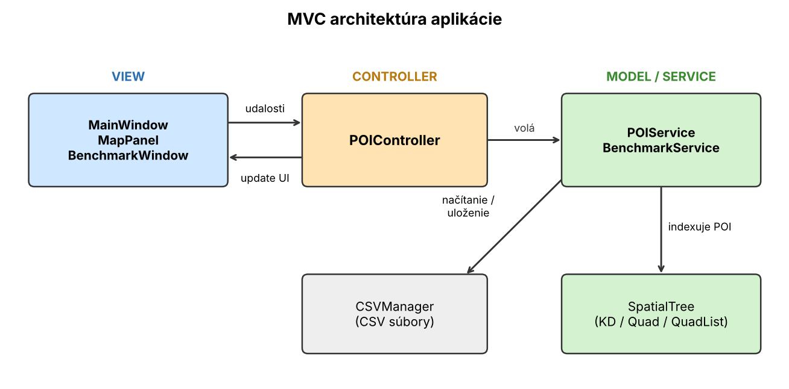
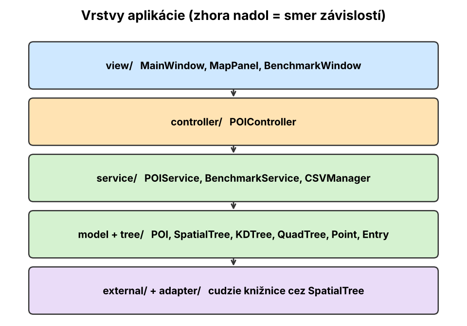
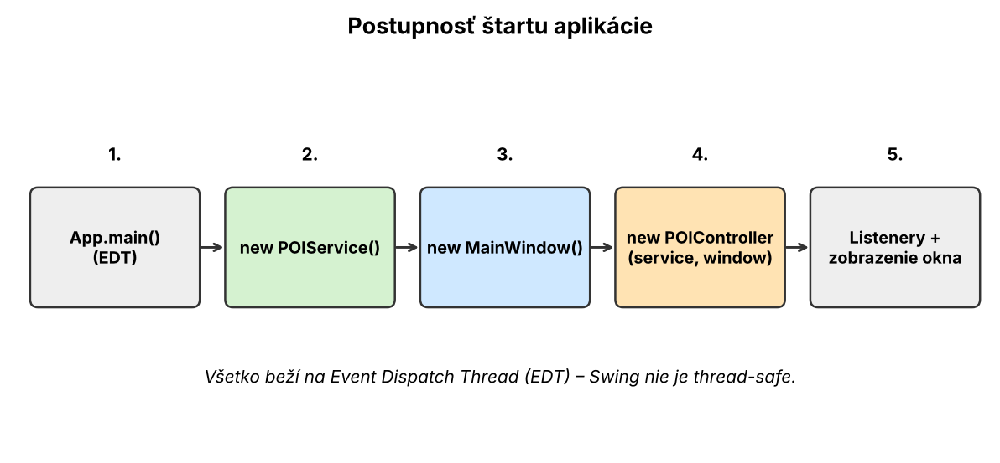
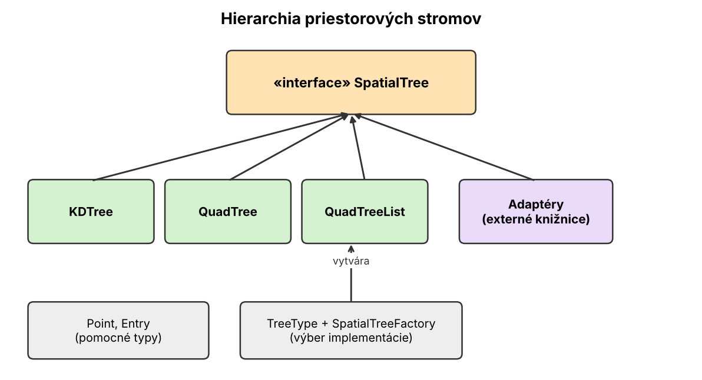
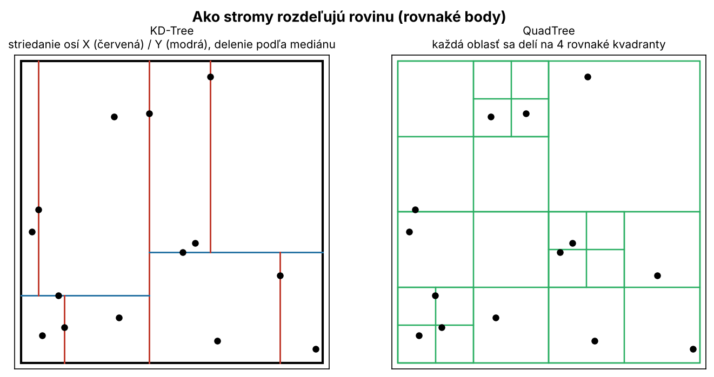
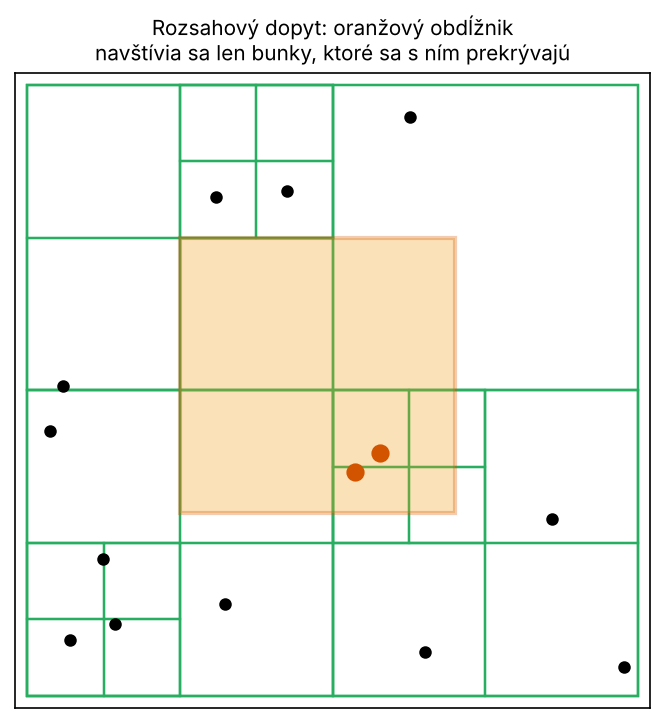
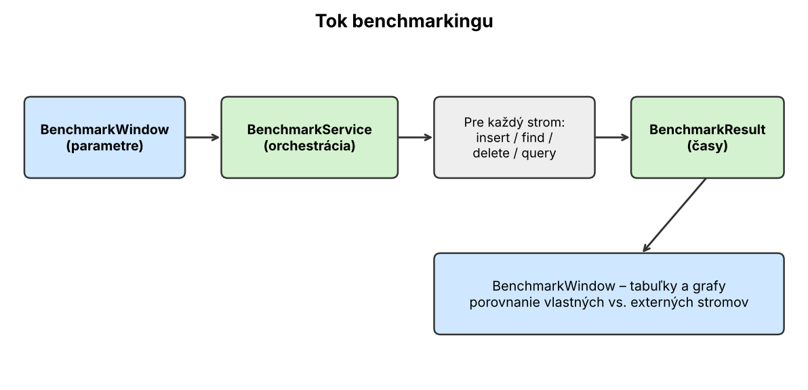

# POI Manager

Desktopová aplikácia v Jave (Swing) na správu **bodov záujmu (POI – Points of Interest)**, napríklad kaviarní, pamiatok alebo staníc. Hlavná myšlienka: POI sa ukladajú do **priestorových stromových štruktúr**, aby sa dalo rýchlo hľadať podľa polohy. Aplikácia ich zobrazuje na mape a obsahuje aj nástroj na **porovnanie výkonu** rôznych stromov.

## Čo aplikácia vie

| Oblasť | Popis |
|---|---|
| Správa POI | Pridanie, zobrazenie, úprava a mazanie bodov (CRUD) |
| Priestorový index | KD-Tree, QuadTree, QuadTreeList – prepínateľné |
| Perzistencia | Načítanie a uloženie POI do CSV |
| Mapa | Interaktívna vizualizácia bodov (JXMapViewer2) |
| Benchmarking | Meranie rýchlosti operácií nad rôznymi stromami |
| Porovnanie | Vlastné stromy vs. externé knižnice cez adaptéry |

---

## 1. Architektúra

Aplikácia používa vzor **MVC (Model – View – Controller)**:

- **View** – okná a panely (`MainWindow`, `MapPanel`, `BenchmarkWindow`). Len zobrazujú a zachytávajú akcie používateľa.
- **Controller** – `POIController`. Prijíma udalosti z okna, volá službu a potom aktualizuje UI.
- **Model / Service** – `POIService` (logika nad POI a indexom) a `BenchmarkService` (merania).



### Vrstvy a smer závislostí

Vyššie vrstvy poznajú nižšie, nie naopak. Vďaka tomu sa dá strom vymeniť bez zásahu do UI.



### Štart aplikácie

Vstupný bod je metóda `App.main`. Vytvára objekty v pevnom poradí a celé UI inicializuje na **Event Dispatch Thread (EDT)**, pretože Swing komponenty nie sú thread-safe.

1. `POIService` – logika a dáta
2. `MainWindow` – okno
3. `POIController` – dostane službu aj okno, pripojí listenery



---

## 2. Priestorové dátové štruktúry

### Prečo vôbec stromy?

Keby POI ležali v obyčajnom zozname, každé hľadanie "všetko v tomto obdĺžniku" by prešlo **všetky** body (O(n)). Priestorový strom rozdelí rovinu na oblasti a celé oblasti, ktoré s dopytom nesúvisia, **preskočí**.

### Spoločné rozhranie

Všetky stromy implementujú rozhranie **`SpatialTree`**. Vďaka tomu ich `POIService` používa rovnako a dajú sa jednoducho porovnávať.

- **`Point`** – súradnice bodu
- **`Entry`** – záznam v strome (bod + priložené dáta, napr. POI)
- **`TreeType`** + **`SpatialTreeFactory`** – výber, ktorý strom sa vytvorí



### KD-Tree vs. QuadTree

| | **KD-Tree** | **QuadTree** |
|---|---|---|
| Delenie | Binárne, osi sa striedajú (X, Y, X, …) | Na 4 rovnaké kvadranty |
| Deliaca čiara | Určená bodmi (typicky medián/hodnota bodu) | Pevne v strede oblasti |
| Tvar stromu | Vyváženosť závisí od poradia vkladania | Hĺbka závisí od zhlukovania bodov |
| Silná stránka | Kompaktný, dobré pre nerovnomerné dáta | Jednoduchá geometria, dobré pre mapy |
| Slabá stránka | Pri nevyváženosti degraduje na zoznam | Husté zhluky vedú k hlbokým vetvám |

**QuadTreeList** je variant QuadTree, ktorý v listoch drží body v zozname (pozri benchmarky na porovnanie).



### Rozsahový dopyt (range query)

Typická operácia: *"nájdi všetky POI v tomto obdĺžniku"*. Strom navštívi iba bunky, ktoré sa s obdĺžnikom **prekrývajú**; zvyšok vynechá.



---

## 3. Doménová a servisná vrstva

### `POI` – model
Bod záujmu s atribútmi (názov, popis, súradnice a pod.).

### `POIService` – jadro logiky
Najväčšia trieda biznis vrstvy. Zodpovedá za:

- **CRUD** – vytvorenie, čítanie, úprava, mazanie POI
- **Správu indexu** – pri každej zmene udržiava strom v súlade s dátami
- **Priestorové dopyty** – vyhľadávanie podľa polohy / oblasti
- **Prepínanie typu stromu** – cez `TreeType` a `SpatialTreeFactory`

### `CSVManager` – ukladanie
Načíta POI zo súboru CSV pri štarte a uloží ich späť. Je to jednoduchá perzistencia bez databázy.

---

## 4. Používateľské rozhranie

- **`MainWindow`** – hlavné okno, ovládacie prvky a zoznam POI
- **`MapPanel`** – mapa s bodmi, postavená na knižnici JXMapViewer2
- **`POIController`** – najväčšia trieda UI vrstvy; prepája tlačidlá, formuláre a mapu so `POIService`

---

## 5. Benchmarking

Slúži na zodpovedanie otázky: *"Ktorý strom je pre moje dáta najrýchlejší?"*

- **`BenchmarkService`** – spúšťa merania nad všetkými stromami s rovnakými vstupmi
- **`BenchmarkResult`** – uchováva namerané časy
- **`BenchmarkWindow`** – tabuľky a grafy výsledkov



> Tip: pri meraní v Jave treba rátať s *warm-up* JVM a opakovať merania, inak sú prvé výsledky skreslené JIT kompiláciou.

---

## 6. Externé referenčné implementácie

V priečinku `external/` sú priložené cudzie knižnice (QuadTree a KD-Tree). **Adaptérová vrstva** ich obalí do rozhrania `SpatialTree`, takže:

- fungujú v aplikácii rovnako ako vlastné stromy,
- dajú sa férovo porovnať v benchmarkoch,
- slúžia ako kontrola správnosti vlastnej implementácie.

---

## 7. Build a spustenie

- Build systém: **Gradle** (v repozitári sú wrapper skripty `gradlew`)
- Konfigurácia: `app/build.gradle`, `settings.gradle`, `gradle.properties`, `gradle/libs.versions.toml`
- Vyžaduje sa príslušný **JDK** (toolchain je nastavený v `app/build.gradle`)
- Kľúčové závislosti: **algs4.jar** (Sedgewick–Wayne), **Guava**, **JXMapViewer2**
- Vstupná trieda je určená v `META-INF/MANIFEST.MF`

```bash
./gradlew build   # zostavenie
./gradlew run     # spustenie aplikácie
./gradlew test    # JUnit testy
```

---

## 8. Testovanie a nástroje

| Nástroj | Čo overuje |
|---|---|
| `POIServiceTest` | CRUD a logika `POIService` |
| `AppTest` | Základné spustenie aplikácie |
| `ExternalLibrariesTest` | Správnosť adaptérov externých knižníc |
| `TreeTester` | Samostatný program na ad-hoc porovnanie správnosti a rýchlosti stromov |

Repozitár používa aj `.gitignore` a `.gitattributes` na udržiavanie poriadku (build výstupy, konce riadkov a pod.).

---

## Rýchly slovník

| Pojem | Význam |
|---|---|
| **POI** | Point of Interest – bod záujmu |
| **MVC** | Rozdelenie na model, view a controller |
| **EDT** | Event Dispatch Thread – vlákno Swing UI |
| **SpatialTree** | Spoločné rozhranie priestorových stromov |
| **Entry** | Záznam v strome (bod + dáta) |
| **Range query** | Dopyt na všetky body v oblasti |
| **Adapter** | Obal, ktorý prispôsobí cudziu triedu na vlastné rozhranie |
| **Benchmark** | Meranie výkonu operácií |
